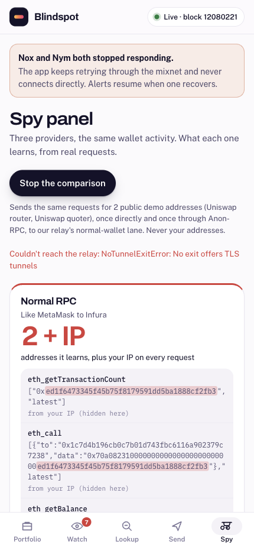
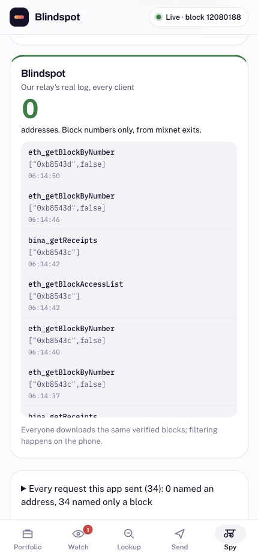
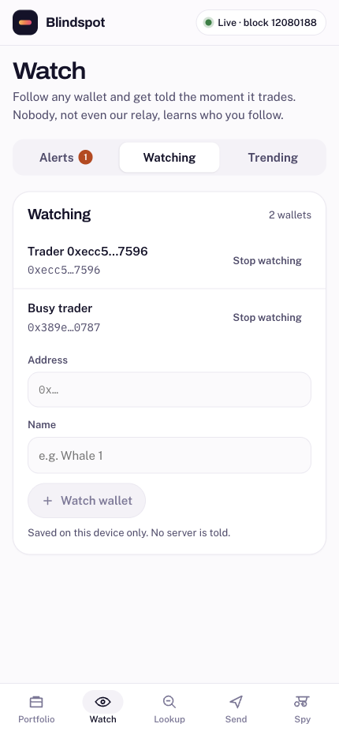
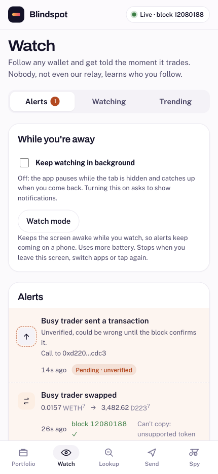
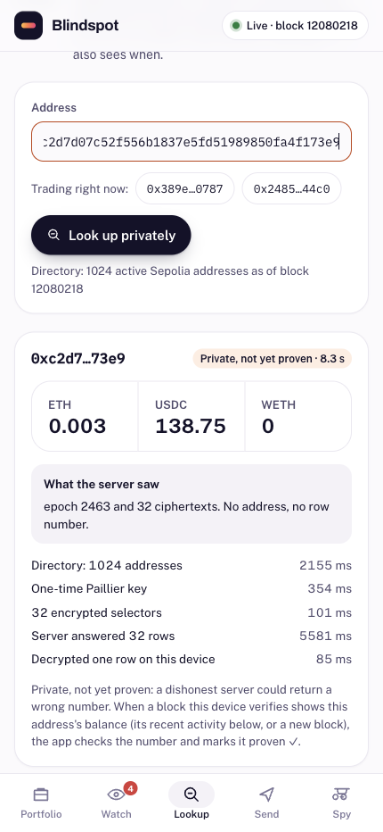
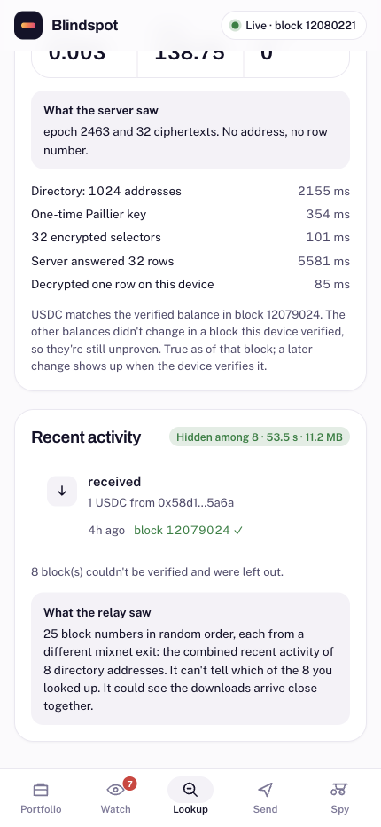
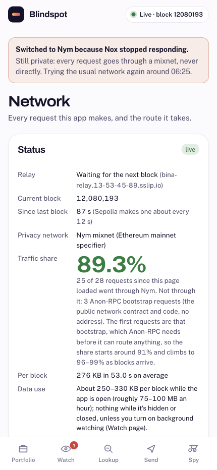
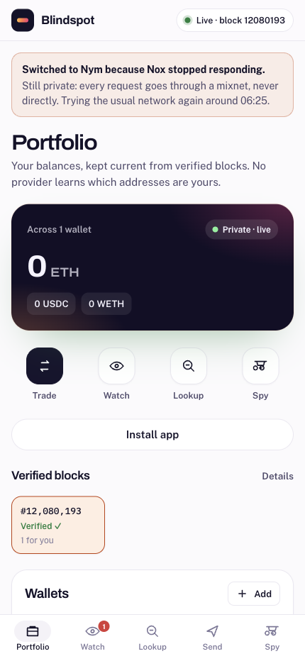
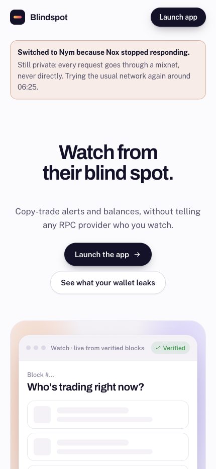

# Demo backup (laptop walkthrough, Nov 7)

Captured on the live site (https://useblindspot.xyz/) with a browser at phone size (430 px), following
`docs/DEMO.md`. Use these if the mixnet is down while recording; see "If the network is down" in `docs/DEMO.md`.

Not captured: the copy-trade screen. At capture time no watched wallet had a copyable verified swap (ETH, WETH or
USDC only). The flow is shown in `docs/TESTING.md`, step 9.

During the capture, Nox and Nym were both unstable. Some frames show the app's failover banners; that is the real
state at that moment, not staged.

| # | Screen | What it shows | Taken |
| --- | --- | --- | --- |
| 01 |  | Spy panel: a normal RPC learns the addresses and your IP (masked in this screenshot); Blindspot sends block numbers only. The banner shows the mixnet outage of Nov 7 and the app refusing to go direct. | 00:50:57 UTC, Nov 7 |
| 02 |  | Our relay's own log of what it received: block numbers and method names, from mixnet exits. | 00:44:59 UTC, Nov 7 |
| 03 |  | Watch → Watching: the whale is followed on the device; nobody learns who you watch. | 00:45:02 UTC, Nov 7 |
| 04 |  | Watch → Alerts: verified alerts (block N ✓), a pending one marked unverified, 'Can't copy: unsupported token', and the 'While you're away' controls. | 00:45:03 UTC, Nov 7 |
| 06 |  | Private lookup (PIR) of the whale: the server saw an epoch and ciphertexts, never the address. | 00:51:09 UTC, Nov 7 |
| 07 |  | Recent activity hidden among 8 wallets (53.5 s, 11.2 MB through Nym), and the PIR answer checked against those verified blocks: 'Partly proven ✓ (USDC)'. | 00:52:04 UTC, Nov 7 |
| 08 |  | Network: relay status, current block, traffic share through Anon-RPC, data use. | 00:48:11 UTC, Nov 7 |
| 09 |  | Portfolio: balances kept current from verified blocks. | 00:48:14 UTC, Nov 7 |
| 10 |  | Landing: 'Watch from their blind spot.' | 00:48:18 UTC, Nov 7 |
